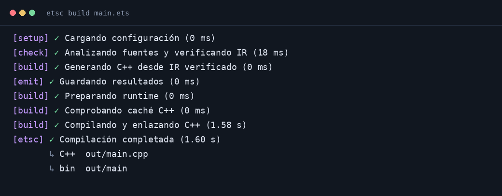

# Salida del compilador

La terminal usa una presentación inspirada en la organización de fases de
`astro build`: etiquetas de color, una fila activa y tiempos legibles. La
identidad y los mensajes son de Estatic.



La imagen se ha renderizado desde la salida ANSI capturada al compilar un
programa real; los tiempos corresponden a esa ejecución de ejemplo.

## Compilar proyectos

```sh
etsc build main.ets
etsc run main.ets
etsc build main.ets --verbose
etsc build main.ets --no-progress
```

Las etiquetas distinguen configuración (`setup`), análisis (`check`), generación
(`build`) y escritura de resultados (`emit`). La fila activa se actualiza sin
acumular mensajes. Al acabar, quedan las fases terminadas y su duración. El
resumen interactivo muestra las rutas de C++ y del ejecutable, relativas al
proyecto cuando están dentro de él.

Los tiempos cortos se muestran en milisegundos; a partir de un segundo, en
segundos con dos decimales; a partir de un minuto, en minutos y segundos.
`--verbose` conserva los comandos, detalles de caché y trazas del frontend.

## Construir la semilla y el bootstrap

```sh
bash native-cpp/build-all.sh
bash scripts/build-ets-compiler.sh stage2
```

La construcción identifica por separado la semilla C++ y el análisis y la
compilación de cada generación ETS. Los comandos largos de la semilla muestran
una animación con tiempo transcurrido. Las advertencias y errores aparecen sin
esperar al final del comando; un error conserva el estado de salida original.
Cancelar una animación con Ctrl+C termina también el grupo de procesos del
comando.

En terminal interactiva se usa una salida compacta. Para ver las trazas
completas de la construcción del bootstrap:

```sh
ESTATIC_BUILD_VERBOSE=1 bash scripts/build-ets-compiler.sh stage2
```

Los registros de CI conservan las trazas completas. `timings.tsv` sigue midiendo
los comandos reales con `/usr/bin/time`; `stage2-analysis.log` conserva la salida
del compilador, sin los controles de la animación del shell.

## Terminales y redirecciones

La presentación usa stderr. El stdout del programa y los protocolos JSON/IR
permanecen disponibles para su uso habitual. Los compiladores no animan la
salida redirigida; el modo predeterminado sigue siendo silencioso en pipes.
Los scripts de construcción sí dejan mensajes de etapa en texto plano.

`--no-progress`, `NO_COLOR` (incluso vacío), `TERM=dumb` y un `CI` no vacío
suprimen las animaciones y los colores. Los diagnósticos no se silencian.
La implementación ETS, el coordinador C++ y la CLI de desarrollo comparten
etiquetas, colores y unidades de tiempo; la instalación y la construcción de la
semilla no necesitan Node para presentar el progreso.
